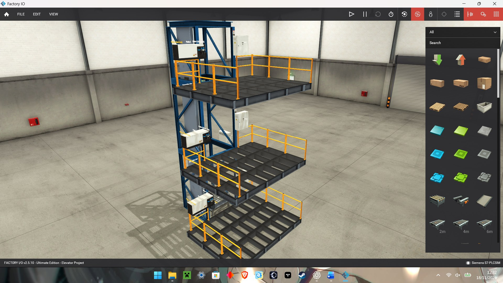

# Kendali Elevator Tiga Lantai dengan Siemens S7-1200

Proyek ini memodelkan kendali satu elevator yang melayani tiga lantai. Program Ladder Diagram (LAD) dijalankan pada CPU Siemens SIMATIC S7-1200 yang disimulasikan dengan S7-PLCSIM. Factory I/O memodelkan tombol, sensor posisi, mekanisme gerak elevator, dan aktuator pada tiap lantai.

## Berkas proyek

| Berkas | Keterangan |
| --- | --- |
| [Proyek TIA Portal V21](tia-portal/FactoryIO_Template_S7-1200_V20_V21.zip) | Arsip ZIP berisi folder proyek STEP 7 dan berkas pembuka `.ap21`. |
| [Scene Elevator Project](factory-io/Elevator%20Project.factoryio) | Model Factory I/O dengan pemetaan driver Siemens S7-PLCSIM. |

## Logika kendali

1. **Aktivasi sistem.** Tombol START menyetel bit internal dengan kumparan *set*. Tombol STOP digunakan pada jalur *reset*.
2. **Permintaan lantai.** Setiap lantai memiliki dua masukan tombol. Setelah sistem aktif, penekanan salah satu tombol menyimpan permintaan melalui kumparan *set*. Network terpisah menangani pemilihan dan penghapusan target serta penghapusan permintaan.
3. **Arah dan posisi.** Sensor kapasitif menghasilkan status posisi untuk tiga lantai. Network naik dan turun mengevaluasi kondisi posisi dan target. Masing-masing memeriksa agar arah lawan tidak aktif sebelum menyetel keluarannya. Program juga menyimpan sensor terakhir dan arah gerak terakhir.
4. **Aktivasi pintu.** Program menulis kode keadaan pintu dengan instruksi MOVE. Network keluaran memeriksa posisi dan kode tersebut untuk mengendalikan pusher pada lantai terkait. Network `TIMER DOOR DELAY` mengatur jeda sebelum keadaan pintu direset.

Ringkasan ini disusun dari struktur network LAD, simbol PLC yang tersimpan, dan pemetaan scene. Urutan layanan untuk beberapa permintaan yang masuk bersamaan masih memerlukan pengujian simulasi.

## Pemetaan I/O

Alamat berikut menggunakan penomoran PLC pada driver Siemens S7-PLCSIM. Scene mengatur offset masukan dan keluaran Boolean ke 0.

| Alamat PLC | Fungsi pada program | Komponen di Factory I/O |
| --- | --- | --- |
| `%I0.0` | START | Push Button (NO) 7 |
| `%I0.1` | STOP | Push Button (NC) 0 |
| `%I0.2`–`%I0.4` | GET FLOOR 1–3 | Push Button (NO) 3, 4, 5 |
| `%I0.5`–`%I0.7` | BUTTON FLOOR 1–3 | Push Button (NO) 0, 1, 2 |
| `%I1.0`–`%I1.2` | Sensor lantai 1–3 | Capacitive Sensor 0, 1, 2 |
| `%Q0.0` | Elevator naik | Elevator 0 (Up) |
| `%Q0.1` | Elevator turun | Elevator 0 (Down) |
| `%Q0.2`–`%Q0.4` | Aktuasi pintu lantai 1–3 | Pusher 1, 0, 2 |

## Menjalankan simulasi

Perangkat lunak yang diperlukan ialah TIA Portal V21 dengan STEP 7, S7-PLCSIM V21, dan Factory I/O edisi Siemens atau Ultimate yang mendukung driver S7-PLCSIM. Proyek menggunakan CPU 1211C DC/DC/DC. Scene disimpan dengan Factory I/O 2.5.10.

1. Ekstrak ZIP secara utuh, lalu buka `FactoryIO_Template_S7-1200_V20_V21.ap21` di TIA Portal V21.
2. Pilih CPU, jalankan **Start simulation**, muat konfigurasi dan program ke S7-PLCSIM, lalu setel CPU ke **RUN**. Pertahankan Network 1 pada OB1 karena network tersebut merupakan bagian dari integrasi template dengan Factory I/O.
3. Buka `Elevator Project.factoryio`. Pada **File → Driver Configuration**, pilih **Siemens S7-PLCSIM** dan model **S7-1200 (V20-21)**. Klik **Connect**, lalu jalankan scene.
4. Tekan START dan uji permintaan tiap lantai. Pantau sensor lantai, keluaran naik dan turun, serta pusher lantai yang dituju. Uji juga STOP dan permintaan yang masuk secara berurutan untuk mengamati perubahan status.

Untuk rincian konfigurasi, lihat [panduan S7-PLCSIM V20–21](https://docs.factoryio.com/tutorials/siemens/setting-up-s7-plcsim-v20/) dan [referensi driver](https://docs.factoryio.com/manual/drivers/s7-plcsim/).

## Lisensi

[Lisensi MIT](LICENSE) berlaku untuk bagian orisinal yang dibuat oleh Yunachz, termasuk logika elevator, rancangan scene, dan dokumentasi. Proyek TIA Portal menggunakan template integrasi Factory I/O. Template, komponen bawaan simulator, dan materi pihak ketiga tetap mengikuti ketentuan masing-masing.
